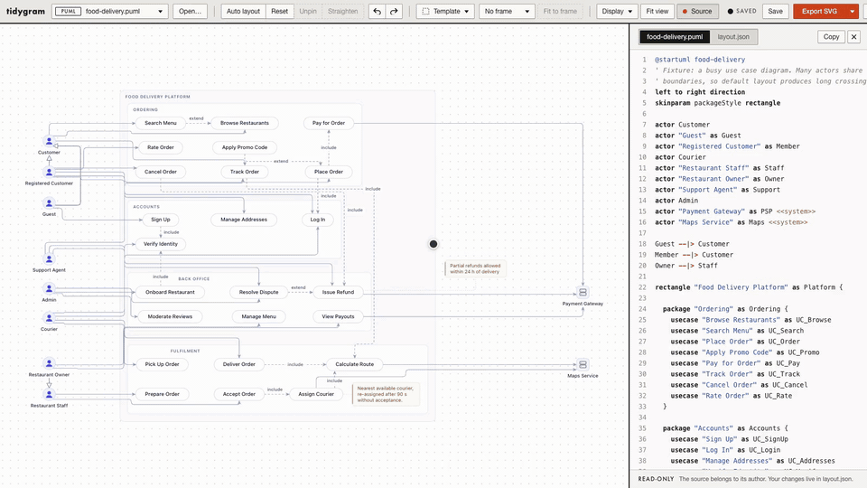

# tidygram

Make diagrams you don't own look right, without touching them.

PlantUML and Mermaid decide where every box goes. All you can do is add
hints to the source (`-left->`, hidden links, `together`), and the
picture still won't put a box where you want it. tidygram leaves the
source exactly as it is and keeps your layout in a separate file next to
it, `diagram.layout.json`: positions, bends, theme and frame, keyed by the
element ids. When the author edits the source, your layout survives and
new elements land next to what they connect to.

**Try it in your browser:** <https://georgi.alexandrov.dev/tidygram/> (open a
file or drop it on the page; nothing is uploaded).

## What it reads

- **PlantUML**: use case, component, deployment, class, ER, state, activity,
  sequence, C4, mindmap, WBS, Gantt, timing, JSON/YAML, ArchiMate, nwdiag.
- **Mermaid**: flowchart, sequence, class, state, ER, Gantt, mindmap.
- **draw.io**: including compressed and multi-page files.

It also converts between the three, carrying the layout, and exports SVG and PNG.

## Run it locally

    pnpm install
    pnpm dev                                   # editor on http://localhost:5199
    PUML_ROOT=~/diagrams pnpm dev              # edit the diagrams in another folder
    pnpm render diagram.puml -o diagram.svg    # CLI: render with the stored layout
    pnpm render diagram.puml --fit 16:9        # re-arrange to fill a slide

In the editor, drag boxes (lines re-route as you drag), bend lines, pick a
theme, fit to a frame, or apply a layered, hexagonal, clean or C4 tiers
template. Every change goes to `diagram.layout.json`; the source is
read-only.

## The sidecar

    {
      "version": 1,
      "view": { "theme": "modern", "frame": [16, 9] },
      "nodes": { "Orders": { "x": 421, "y": 172, "pinned": true } },
      "edges": { "Orders-->Payments": { "via": [[520, 172]] } }
    }

Node keys are the ids in the source (aliases, or names when there is no
alias); edge keys are `from-->to`. Commit it next to the diagram, or keep
it to yourself.

## More

The [reference](docs/reference.md) has the full support tables, conversion
details, templates, C4 zoom levels, every CLI flag, editor shortcuts,
themes, the complete `layout.json` format and how the engine works.

    pnpm test && pnpm typecheck

MIT licence.
